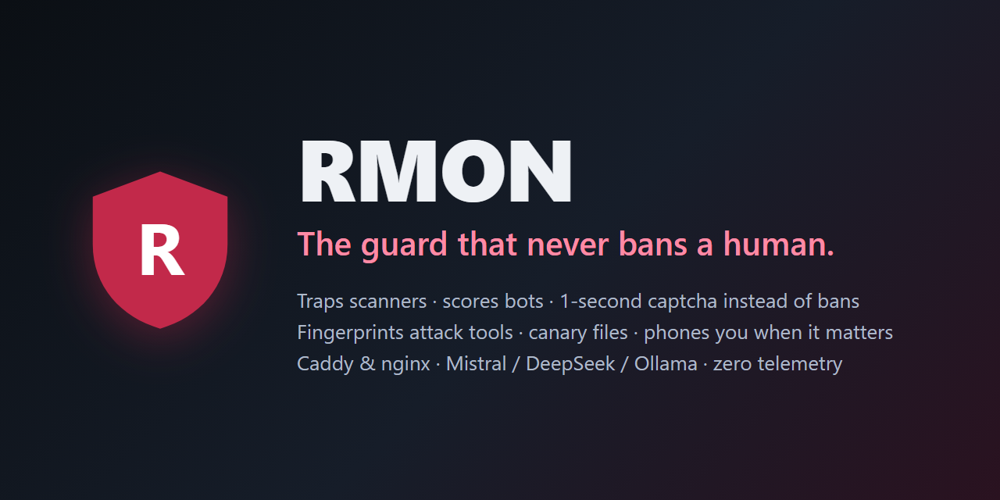
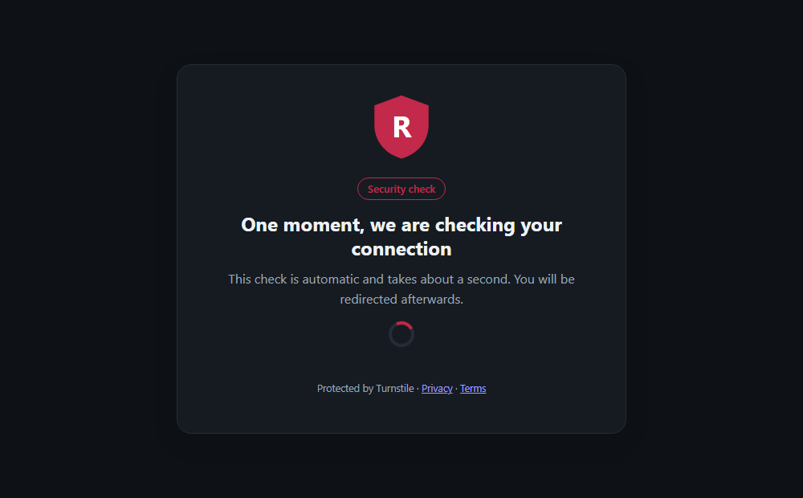
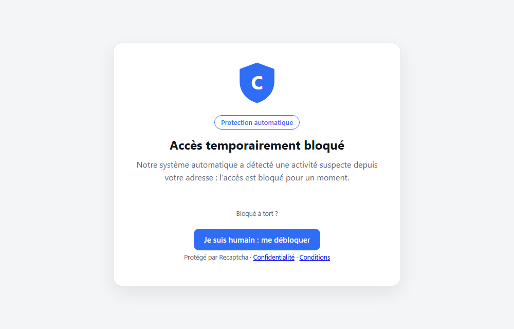
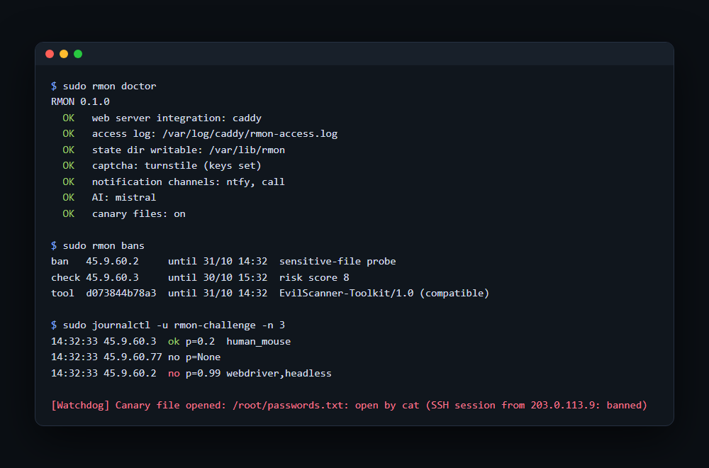

<p align="center"></p>

<p align="center">
  <a href="https://github.com/Bismela21/rmon/actions/workflows/ci.yml"></a>
  <a href="LICENSE"></a>
  
  
  
</p>

# RMON - the guard that never bans a human

Every public web server is hammered by scanners, brute-forcers and AI-driven attack tools. The usual answer is a ban list, and a ban list will eventually lock out a real customer, your own admin, or a search engine.

**RMON takes a different position:** *be certain before you ban, challenge when you are not.* It reads your access log, bans the obvious attackers instantly, and turns every ambiguous case into a one-second automatic captcha that a human never notices and a bot cannot pass. It also fingerprints attack tools, plants canary files on your machines, and calls your phone when it really matters.

Self-hosted. Caddy or nginx. Python standard library only. **No telemetry, no account, nothing leaves your server unless you turn it on.**

<p align="center">
  
  
</p>
<p align="center"><sub>Left: the automatic check (about one second, no click). Right: the block page, here renamed "Cerb&egrave;re", blue, in French. Name, logo, colour and language are yours.</sub></p>

## What you get

| | |
|---|---|
| **Two-tier detection** | *Certain* (requests for `/.env`, `/.git`, `phpinfo.php`, PHP in uploads, SQL injection, scanner user-agents) &rarr; instant ban. *Ambiguous* (many 404s, failed logins, a rising risk score) &rarr; **challenge, never a ban**. |
| **Bot probability** | The challenge combines the captcha score, the browser environment (webdriver, headless, software GL), *behaviour* (trusted input events, the shape of the mouse trajectory) and history into one probability. Unsure? One confirmation click. Clearly a robot? It stays blocked. The model is ~40 readable lines: [`rmon/rules.py`](rmon/rules.py). |
| **Fingerprinting** | Attackers rotate addresses, not tools. The same rare fingerprint behind 3 banned addresses (and no normal visitor) gets the *tool* blocked. A fingerprint seen from one of your trusted addresses is never blocked. |
| **Canary files** | Fake `passwords.txt`, `.aws/credentials`, SSH keys and SQL dumps. Opening one raises an alert naming the exact process and, for SSH sessions, the client address, which is banned. The open is always allowed: RMON only watches. |
| **Alerts that reach you** | Telegram, [ntfy](https://ntfy.sh) (free push, no account), e-mail, webhook, and a **phone call** for critical alerts: Twilio, your own Asterisk/SIP PBX, or any command. |
| **Optional AI, read-only** | Mistral, DeepSeek, OpenAI, a local Ollama or any OpenAI-compatible API explains incidents in plain words. It can never ban, unban or run anything, and IP addresses are masked before anything is sent. |
| **Yours** | Rename the bot, add your logo and colour, English or French pages, your own captcha keys (reCAPTCHA v3, Cloudflare Turnstile, hCaptcha, or none). |

## Install in two minutes

```bash
curl -fsSL https://raw.githubusercontent.com/Bismela21/rmon/main/install.sh | sudo RMON_REPO=Bismela21/rmon bash
sudo rmon setup            # about 8 short questions; everything has a default or is detected
# paste the one or two lines it prints into your Caddy / nginx config, then:
sudo systemctl enable --now rmon-guard rmon-challenge
sudo rmon doctor
```

Or download the `.deb` from [Releases](https://github.com/Bismela21/rmon/releases) (SHA-256 provided) and `sudo apt install ./rmon_all.deb`. Unattended: `rmon setup --answers answers.json`.

<p align="center"></p>
<p align="center"><sub>Typical output (illustrative values).</sub></p>

## Why not just fail2ban?

fail2ban is excellent at one thing: ban an address after N matching log lines. That is exactly why it is risky on its own: a forgotten password, a freshly installed site that 404s a hundred assets, or a shared office address gets banned like an attacker. RMON keeps the instant ban for what is *certain* and adds what a regex cannot do: a challenge for the ambiguous cases, behaviour and fingerprint scoring, fake secrets that alert on access, and alerts that can ring your phone. Run it next to fail2ban, a WAF or a CDN: it complements them.

## Safe by design

* **No lock-out.** Private ranges, Cloudflare edges, your `never_ban` list, addresses you `rmon trust`, and verified search-engine crawlers (reverse DNS then forward DNS) are never touched.
* **Unprivileged internet-facing part.** The challenge server runs as an unprivileged user and only edits state files; the root guard re-applies your web-server configuration, validates it (`caddy validate` / `nginx -t`) and rolls back on failure.
* **No shell injection.** The phone-call command driver never goes through a shell; user data stays a single argument.
* **Stdlib only, 34 tests**, and CI that refuses committed secrets.

## Commands

| Command | |
|---|---|
| `rmon setup` | wizard (config, secrets, web-server snippets) |
| `rmon guard` / `challenge` / `canary` | the three services (systemd units included) |
| `rmon bans` | active bans, challenges and fingerprint blocks |
| `rmon unban <ip\|all>` &middot; `rmon trust <ip>` | lift a ban &middot; never touch this address again |
| `rmon doctor` &middot; `rmon status` | health checks &middot; counters |
| `rmon notify-test` | test alert (rings the phone if configured) |
| `rmon explain` | plain-words summary of recent bans (if AI enabled) |

## Documentation

[Install](docs/INSTALL.md) &middot; [Configuration](docs/CONFIG.md) &middot; [Caddy](docs/CADDY.md) &middot; [nginx](docs/NGINX.md) &middot; [Phone calls](docs/VOIP.md) &middot; [Architecture & detections](docs/ARCHITECTURE.md) &middot; [Privacy](docs/PRIVACY.md) &middot; [Security policy](SECURITY.md) &middot; [Fran&ccedil;ais](README.fr.md)

## Honest limits

* A bot driving a *real* browser with stealth patches, a good captcha score and human-like mouse movement can pass. No tool detects that for certain; RMON raises the cost and removes the cheap bots.
* Behind Cloudflare the origin cannot see the TLS (JA3) fingerprint; RMON fingerprints the HTTP headers instead.
* Real people on VPNs or privacy browsers sometimes get a low captcha score: they get one confirmation click, never a ban.
* It is a defensive layer, not a full WAF.

## Roadmap

Android app (push and status, with your own Firebase or just ntfy), signed apt repository, Cloudflare firewall backend, optional Proxmox module (host-level collection, auto-isolation of a compromised guest), WordPress sentinel plugin, more traps.

## License

[GNU AGPL-3.0](LICENSE). Run a modified version as a network service and you must offer its source to your users.
